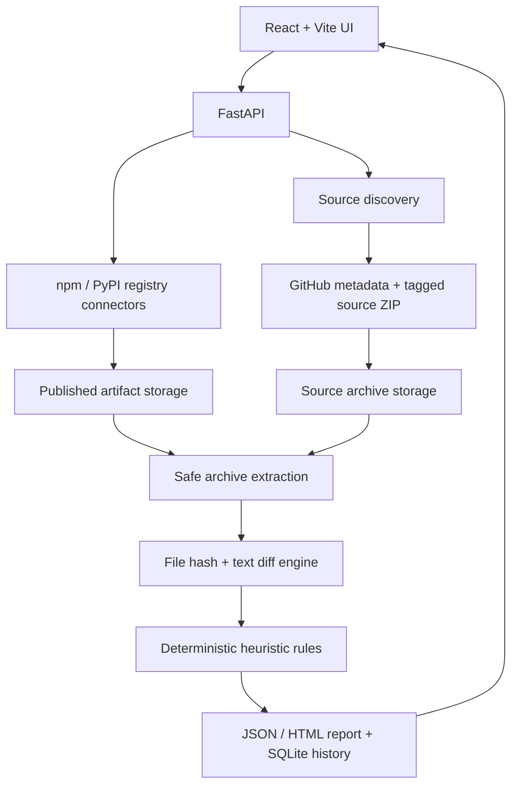

# PackSleuthY architecture

## Trust boundaries

Registry artifacts, GitHub metadata, and source archives are untrusted input. The backend treats them as bytes and metadata only. It does not install dependencies, import downloaded modules, execute scripts, invoke build tools, or run package code.

## Matching model

The source repository is taken from metadata for the exact package version. The backend looks for exact version tags and common tag prefixes. If no exact tag is found, it reports uncertainty and does not fall back to the repository default branch.

## Comparison model

The archive extractor rejects unsafe path entries, links, and special files, and enforces file-count and expanded-size limits. File contents are hashed. UTF-8 text files up to the configured size threshold receive a unified diff; binary and non-text files are represented by hashes and sizes.

## Detection model

The current rules are deterministic indicators over added/modified paths and text diffs. A finding is not a verdict. Missing indicators do not establish safety, and source/build differences may be legitimate.
